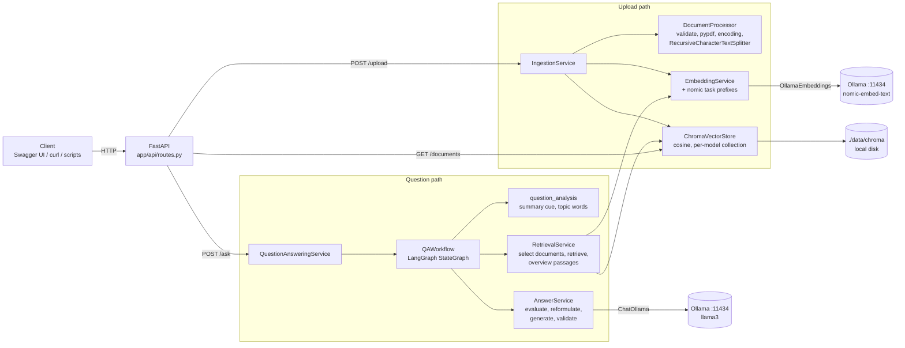
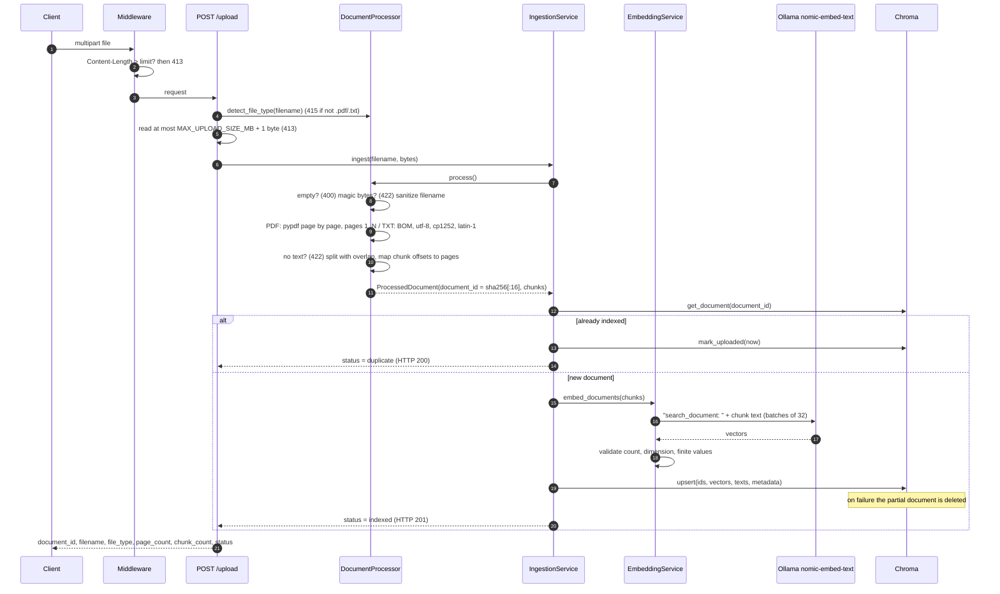
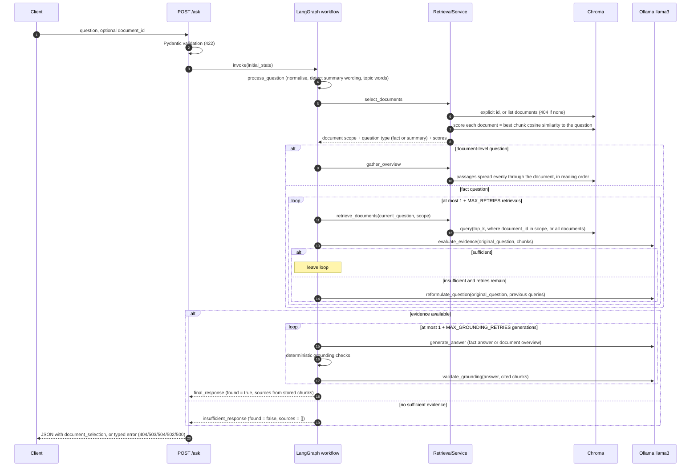
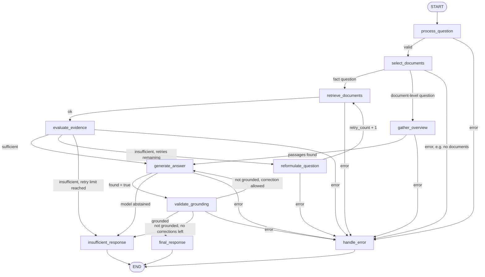

# AI-Powered Document Q&A System (Local, Zero-Cost)

Upload PDF or TXT documents, ask questions about them, and get answers that are
generated **only from the documents**, with the exact passages and page numbers
used. You do not need a document ID: the service picks the relevant document by
itself and shows the relevance scores it used. Questions about a whole document
("What is this PDF about?") get an overview. When the documents do not contain the
answer, the service says so instead of guessing.

Everything runs on your own machine: **FastAPI** for the API, **LangGraph** for the
question-answering workflow, **LangChain** for document processing and model
access, **Ollama** for the local models (`llama3` + `nomic-embed-text`) and
**Chroma** as a persistent local vector store. No paid API, cloud service or
LangSmith account is used, and uploaded content never leaves the machine.

> **Verification status (be precise in your evaluation):** the full automated
> suite (173 tests) passes on Python 3.11, 3.12 and 3.13. The real FastAPI server,
> PDF/TXT parsing, Chroma persistence, automatic document selection, document
> overviews, the LangGraph retry and abstention paths,
> and the LangChain Ollama clients over HTTP were all exercised end to end
> against an Ollama-API stub. **Answer quality with the real `llama3` and
> `nomic-embed-text` models was not verified in the build environment** (Ollama
> downloads were blocked there). Run `python scripts/smoke_test.py` and
> `pytest -m ollama` on your machine to verify it — see [section 28](#28-testing-commands-and-actual-test-coverage).

---

## Contents

1. [Project overview and objectives](#1-project-overview-and-objectives)
2. [Assignment requirements covered](#2-assignment-requirements-covered)
3. [Architecture](#3-architecture)
4. [Document ingestion sequence](#4-document-ingestion-sequence)
5. [Question-answering sequence](#5-question-answering-sequence)
6. [LangGraph workflow](#6-langgraph-workflow)
7. [Folder structure and responsibilities](#7-folder-structure-and-responsibilities)
8. [Technology choices](#8-technology-choices)
9. [Python and dependency requirements](#9-python-and-dependency-requirements)
10. [Ollama installation and verification](#10-ollama-installation-and-verification)
11. [Pulling the models](#11-pulling-the-models)
12. [Configuration reference (.env)](#12-configuration-reference-env)
13. [Windows PowerShell installation](#13-windows-powershell-installation)
14. [Virtual environment](#14-virtual-environment)
15. [Dependency installation](#15-dependency-installation)
16. [Starting the application](#16-starting-the-application)
17. [Swagger UI](#17-swagger-ui)
18. [Upload and ask API examples](#18-upload-and-ask-api-examples)
19. [Supported answer example](#19-supported-answer-example)
20. [Unsupported question example](#20-unsupported-question-example)
21. [HTTP errors](#21-http-errors)
22. [Chunking and embedding strategy](#22-chunking-and-embedding-strategy)
23. [Chroma persistence, document isolation and automatic document selection](#23-chroma-persistence-document-isolation-and-automatic-document-selection)
24. [How relevance is calculated, and evidence sufficiency](#24-how-relevance-is-calculated-and-evidence-sufficiency)
25. [Question reformulation and retry control](#25-question-reformulation-and-retry-control)
26. [Answer grounding and hallucination mitigation](#26-answer-grounding-and-hallucination-mitigation)
27. [How LangGraph state is updated](#27-how-langgraph-state-is-updated)
28. [Testing commands and actual test coverage](#28-testing-commands-and-actual-test-coverage)
29. [Inspecting the graph](#29-inspecting-the-graph)
30. [Troubleshooting](#30-troubleshooting)
31. [Security and privacy](#31-security-and-privacy)
32. [Performance on low-memory hardware](#32-performance-on-low-memory-hardware)
33. [Key design decisions and trade-offs](#33-key-design-decisions-and-trade-offs)
34. [Known limitations and future improvements](#34-known-limitations-and-future-improvements)
35. [Five-minute demonstration checklist](#35-five-minute-demonstration-checklist)
36. [Requirement → code → test traceability](#36-requirement--code--test-traceability)

A beginner-friendly explanation of every part of the system, with 34 interview
questions, is in [`docs/TECHNICAL_WALKTHROUGH.md`](docs/TECHNICAL_WALKTHROUGH.md).
The build-time verification evidence is in [`docs/VERIFICATION_REPORT.md`](docs/VERIFICATION_REPORT.md).

---

## 1. Project overview and objectives

| Objective | How it is met |
|---|---|
| Answer questions from an uploaded PDF/TXT | Retrieval-augmented generation (RAG): chunks are embedded, stored in Chroma, retrieved per question and passed to the LLM |
| Use only document evidence | Three separate checks: evidence relevance/sufficiency, grounded generation with citations, grounding validation |
| Admit when the answer is missing | A fixed abstention response (`found: false`, no sources) on every "not enough evidence" path |
| Show where answers come from | Sources are built from stored chunk text and metadata (document ID, filename, one-based page, chunk index) — never from model output |
| Recover from a poor first search | LangGraph loop: reformulate the search query and retrieve again, at most `MAX_RETRIES` (default 2) times |
| No document ID needed | Without `document_id` the service scores every document against the question (best-chunk cosine similarity) and searches by relevance; the scores and the reason are returned in `document_selection` |
| Answer "what is this document about?" | Document-level questions are detected and answered from passages spread evenly through the document, instead of a fact lookup that would find nothing |
| Run locally at zero cost | Ollama models, local Chroma files, no external services; LangSmith tracing and Chroma telemetry are forced off |

## 2. Assignment requirements covered

| Area | Delivered |
|---|---|
| A. FastAPI endpoints | `GET /health` → `{"status": "ok"}`, `POST /upload` (multipart PDF/TXT), `POST /ask` (JSON question; `document_id` optional — documents are selected by relevance when it is omitted), Swagger at `/docs`. Extras: `GET /documents`, `GET /health/dependencies`, `GET /graph` |
| B. Ingestion | Extension/size/emptiness/magic-byte validation, page-by-page PDF extraction, deliberate TXT encoding detection, recursive splitter with overlap, one-based page ranges (multi-page chunks handled explicitly), content-hash document IDs, duplicate policy, persistent Chroma |
| C. Local models | `ChatOllama` + `OllamaEmbeddings`, all model names/URL from env vars, startup diagnostics for missing Ollama/models, no silent model switching |
| D. Retrieval and evidence | Configurable top-k, similarity used as a ranking signal, structured LLM relevance/sufficiency judgement with validated JSON, conservative handling of malformed output |
| E. LangGraph | Real `StateGraph` with typed state, 11 focused nodes, 8 conditional routers (including fact vs document-level routing), bounded reformulation loop and bounded correction loop, error branch, recursion limit |
| F. Grounded answers | Evidence-only prompt, citation labels mapped to real chunks, deterministic + LLM grounding validation, bounded correction or abstention |
| G. Errors and security | One stable error body for 24 documented error codes, no stack traces/paths in responses, no document text in logs, prompt-injection hardening, `.gitignore` for secrets and indexes |
| Testing | 173 automated tests: 167 unit/API tests (fakes + temporary Chroma) and 6 HTTP-level integration tests against an Ollama-API stub; plus 5 opt-in tests for real Ollama |
| Documentation | This README, `docs/TECHNICAL_WALKTHROUGH.md`, `docs/VERIFICATION_REPORT.md`, generated `docs/langgraph_workflow.mmd` |

## 3. Architecture



Layering rule: **routes → services → (LangChain / Chroma / Ollama)**. Routes contain
no business logic; the graph nodes call services; only the service layer talks to
external libraries. All services are created once in `app/core/container.py`, which
is also how tests inject fakes.

## 4. Document ingestion sequence



## 5. Question-answering sequence



## 6. LangGraph workflow



**Node sequence and stopping conditions**

| Node | Reads | Writes | Next (conditional edge function) |
|---|---|---|---|
| `process_question` | `original_question` | normalised `original_question`, `current_question`, `summary_cue`, `topic_words`, `retry_count=0` | `route_after_process`: error → `handle_error`, else `select_documents` |
| `select_documents` | question, `document_id` (request), `summary_cue`, `topic_words` | `document_selection` (mode, reason, scores), `document_ids` (scope; `None` = all), final `question_type` | `route_after_selection`: error → `handle_error`; `summary` → `gather_overview`; `fact` → `retrieve_documents` |
| `gather_overview` | `document_ids` | `retrieved_documents` (passages spread through the document), `relevance_result` (method `overview`), `evidence_sufficient` | `route_after_overview`: error → `handle_error`; passages → `generate_answer`; none → `insufficient_response` |
| `retrieve_documents` | `current_question`, `document_ids`, previous `relevance_result` | `retrieved_documents` (new top-k + chunks already judged relevant), `chunks_below_floor`, appends `query_history` | `route_after_retrieval`: error → `handle_error`, else `evaluate_evidence` |
| `evaluate_evidence` | `original_question`, `retrieved_documents` | `relevance_result`, `evidence_sufficient` | `route_after_evaluation`: error → `handle_error`; sufficient → `generate_answer`; `retry_count < max_retries` → `reformulate_question`; else `insufficient_response` |
| `reformulate_question` | `original_question`, `query_history`, missing information | `current_question`, `retry_count + 1`, `reformulation_method` | `route_after_reformulation`: error → `handle_error`, else `retrieve_documents` |
| `generate_answer` | `original_question`, `question_type`, relevant chunks, previous grounding issues | `generated_answer`, `generation_attempts + 1`, resets `grounding_result` | `route_after_generation`: error → `handle_error`; `found=false` → `insufficient_response`; else `validate_grounding` |
| `validate_grounding` | `generated_answer`, relevant chunks | `grounding_result` | `route_after_grounding`: error → `handle_error`; grounded → `final_response`; `generation_attempts <= max_grounding_retries` → `generate_answer`; else `insufficient_response` |
| `final_response` | `generated_answer`, `retrieved_documents` | `final_response`, `source_metadata` | END |
| `insufficient_response` | grounding/generation results | fixed abstention, `abstain_reason` | END |
| `handle_error` | `error` | `final_response=None` | END |

**Why it always terminates:** `retry_count` only increases (by exactly 1, only in
`reformulate_question`) and the loop back to retrieval requires
`retry_count < max_retries`. `generation_attempts` only increases (only in
`generate_answer`) and the correction loop requires
`generation_attempts <= max_grounding_retries`. Every other edge moves forward to a
terminal node. The longest possible run is
`2 + 2·(1+MAX_RETRIES) + MAX_RETRIES + 2·(1+MAX_GROUNDING_RETRIES) + 1` = **15 node
executions** with the defaults (the document-level path is shorter), and LangGraph's
`recursion_limit` is set to that bound + 5 as a second safety net (exceeding it returns
`500 WORKFLOW_ERROR`).

## 7. Folder structure and responsibilities

```
document-qa-system/
├── app/
│   ├── main.py                    FastAPI factory, middleware (request id, early 413), error handlers, startup diagnostics
│   ├── api/
│   │   ├── routes.py              Thin endpoint functions: /health, /health/dependencies, /upload, /documents, /ask, /graph
│   │   └── schemas.py             Pydantic request/response/error models (the OpenAPI contract)
│   ├── core/
│   │   ├── config.py              Settings from env/.env with validation; per-model collection name; nomic prefixes
│   │   ├── container.py           Builds and wires all services once (dependency injection point for tests)
│   │   ├── exceptions.py          AppError hierarchy: HTTP status + stable code + safe message
│   │   └── models.py              Internal domain models: ChunkRecord, RetrievedChunk, EvidenceEvaluation, ...
│   ├── services/
│   │   ├── document_processor.py  Validation, PDF/TXT extraction, normalisation, chunking, page mapping
│   │   ├── embedding_service.py   OllamaEmbeddings wrapper: prefixes, batching, vector validation, error mapping
│   │   ├── vector_store.py        Chroma PersistentClient: upsert, filtered query, document discovery
│   │   ├── retrieval_service.py   Document selection with relevance scores, top-k retrieval, overview passages
│   │   ├── question_analysis.py   Rule-based detection of document-level questions, topic words, filename mentions
│   │   ├── answer_service.py      Prompts + structured outputs: evaluate, reformulate, generate, validate grounding
│   │   ├── llm_service.py         ChatOllama client, JSON extraction/validation with bounded repair retry
│   │   ├── ollama_utils.py        Error translation and Ollama/model diagnostics (GET /api/tags)
│   │   ├── ingestion_service.py   Upload pipeline and duplicate policy
│   │   └── qa_service.py          Runs the graph and converts the final state into a response or typed error
│   ├── graph/
│   │   ├── state.py               QAState TypedDict (with append reducers) and initial_state()
│   │   ├── nodes.py               The 11 node functions (one step each, never raise)
│   │   └── workflow.py            StateGraph, conditional routers, recursion limit, QAWorkflow.run()
│   └── utils/
│       └── logging_config.py      Log format; quiets libraries that could log request bodies
├── tests/
│   ├── conftest.py                Fixtures: temp Chroma dir, fake LLM/embeddings, TestClient factory
│   ├── test_health.py             Health, dependencies, Swagger, error body, /graph
│   ├── test_upload.py             Uploads, validation errors, encodings, page mapping, metadata
│   ├── test_ask.py                Answers, overviews, automatic selection, abstention, invalid input, failures, isolation, persistence
│   ├── test_retrieval.py          Retrieval, selection modes, question analysis, prefixes, floor, JSON parsing, grounding units
│   ├── test_graph.py              Reformulation, retry limits, grounding loops, termination of every branch
│   ├── helpers/                   fakes.py (FakeLLM, FakeEmbeddings), pdf_factory.py, ollama_stub.py
│   └── integration/               test_ollama_http_contract.py (stub over HTTP), test_real_ollama.py (opt-in)
├── scripts/
│   ├── smoke_test.py              End-to-end check against a running server with real models
│   ├── benchmark_retrieval.py     Chunk-size / similarity benchmark on the sample handbook
│   ├── export_graph.py            Writes docs/langgraph_workflow.mmd from the compiled graph
│   └── make_sample_pdf.py         Regenerates sample_documents/employee_handbook.pdf
├── sample_documents/              employee_handbook.txt (+ 3-page PDF version); no maternity-leave policy on purpose
├── docs/                          TECHNICAL_WALKTHROUGH.md, VERIFICATION_REPORT.md, langgraph_workflow.mmd
├── data/.gitkeep                  Chroma index is created in data/chroma at runtime (git-ignored)
├── .env.example  .gitignore  pytest.ini  requirements.txt  README.md
```

`app/services/llm_service.py`, `ollama_utils.py`, `ingestion_service.py`,
`qa_service.py`, `question_analysis.py`, `app/core/container.py` and `app/core/models.py` were added to the
suggested structure so that transport, orchestration and domain types each have one
home instead of being mixed into the answer service or the routes.

## 8. Technology choices

### FastAPI (+ Uvicorn)
- **What it does:** HTTP routing, request parsing, automatic OpenAPI/Swagger docs. Uvicorn is the ASGI server that runs it.
- **Why needed:** the assignment requires a REST API with Swagger; FastAPI derives both from the Pydantic models, so docs cannot drift from the code.
- **Input → output:** HTTP requests (multipart upload, JSON) → JSON responses with explicit status codes.
- **How it can fail:** invalid input (handled → `422 VALIDATION_ERROR`), unhandled exceptions (handled → `500 INTERNAL_ERROR` without details), blocking calls on the event loop (avoided: endpoints are sync `def`, so FastAPI runs them in a thread pool while Ollama works).
- **Alternative considered:** Flask — no built-in validation or OpenAPI, so more hand-written code for the same contract.

### Pydantic and pydantic-settings
- **What it does:** typed validation of request bodies, responses, LLM outputs and configuration.
- **Why needed:** the same tool validates user input, model JSON output (`EvidenceAssessment`, `AnswerDraft`, ...) and `.env` values (e.g. `CHUNK_OVERLAP < CHUNK_SIZE`).
- **Input → output:** raw dicts/env strings → typed objects, or a validation error.
- **How it can fail:** schema mismatch → caught and converted (422 for clients, conservative fallback for LLM output).
- **Alternative considered:** manual `dict` checks — error-prone and undocumented.

### LangChain (`langchain-core`, `langchain-text-splitters`, `langchain-ollama`)
- **What it does:** `RecursiveCharacterTextSplitter` for chunking; `ChatOllama` and `OllamaEmbeddings` as maintained clients for the local Ollama API.
- **Why needed:** a tested splitter with separator hierarchy and overlap; model clients that handle streaming, options (`temperature`, `num_ctx`, `num_predict`) and the JSON-schema `format` parameter.
- **Input → output:** text → chunks; messages → `AIMessage`; texts → vectors.
- **How it can fail:** Ollama unreachable (`ConnectionError`), model missing (`ResponseError 404`), timeout — all translated by `ollama_utils.translate_ollama_error` into `503/503/504`.
- **Alternative considered:** calling the Ollama REST API with raw `httpx` — possible, but duplicates request/stream handling that LangChain already maintains. LangChain's `Chroma` vector-store wrapper was **not** used: see Chroma below.

### LangGraph
- **What it does:** runs a `StateGraph` — nodes that update a shared typed state, and conditional edges that pick the next node from that state.
- **Why needed:** the workflow has real loops (re-retrieval, answer correction) and branches (abstain, error). A graph makes each decision an explicit, testable router function with provable bounds, instead of nested `if`/`while` code.
- **Input → output:** `initial_state` → final state (answer or abstention or error, plus a `trace` of visited nodes).
- **How it can fail:** an unbounded loop (prevented by counters + `recursion_limit` → `GraphRecursionError` → `500 WORKFLOW_ERROR`); a node exception (nodes catch everything and route to `handle_error`).
- **Alternative considered:** a plain LangChain chain — linear, cannot express "retry retrieval with a new query" without hand-written loop control.

### Ollama with `llama3:latest` and `nomic-embed-text:latest`
- **What it does:** serves open-weight models locally over `http://localhost:11434`.
- **Why needed:** zero cost and privacy — documents and prompts never leave the machine.
- **Input → output:** `/api/chat` messages → text (JSON); `/api/embed` texts → 768-dimension vectors for nomic-embed-text.
- **How it can fail:** service not running, model not pulled, too little RAM (very slow or killed), timeouts on CPU-only machines. Startup diagnostics and `GET /health/dependencies` report these with the exact `ollama pull` command.
- **Alternatives considered:** `phi3:mini` (smaller and faster, weaker instruction following — available via `LLM_MODEL=phi3:mini`, never switched to silently); hosted APIs (excluded: cost and data leaving the machine).

### Chroma (`chromadb.PersistentClient`)
- **What it does:** stores chunk vectors + text + metadata on disk and answers nearest-neighbour queries with metadata filters.
- **Why needed:** persistence across restarts and `where={"document_id": ...}` filtering for document isolation, with no separate database server.
- **Input → output:** (ids, vectors, texts, metadata) → stored; query vector + filter → nearest chunks with cosine distances.
- **How it can fail:** locked/corrupt files, disk errors (→ `503 VECTOR_STORE_UNAVAILABLE`, or `500 RETRIEVAL_FAILED` during a question), dimension mismatch (→ `500 EMBEDDING_DIMENSION_MISMATCH`).
- **Why the raw client and not LangChain's `Chroma` wrapper:** embeddings are computed explicitly by `EmbeddingService`, so (1) embedding failures and storage failures are separate, typed errors, (2) the exact model and task prefix are under our control, and (3) Chroma's own default embedding function is never invoked.
- **Alternatives considered:** FAISS (no built-in persistence of metadata/filters), pgvector/Qdrant (need a server process).

### pypdf
- **What it does:** pure-Python PDF parsing and per-page text extraction.
- **Why needed:** page-by-page extraction is how one-based page numbers are preserved; no system dependencies, installs cleanly on Windows.
- **Input → output:** PDF bytes → text per page.
- **How it can fail:** corrupted files (→ `422 CORRUPTED_PDF`), encrypted files (→ `422 ENCRYPTED_PDF`), scanned PDFs with no text layer (→ `422 NO_EXTRACTABLE_TEXT`); a single bad page is skipped and reported, not fatal.
- **Alternatives considered:** PyMuPDF (faster, better layout, but AGPL licence); unstructured (heavy dependencies).

### pytest + FastAPI TestClient
- **What it does:** runs the API in-process with fake models and temporary Chroma directories.
- **Why needed:** deterministic tests that need no Ollama and never touch `./data`.
- **Alternatives considered:** only manual testing — not repeatable, cannot force failures such as a broken vector store.

## 9. Python and dependency requirements

- **Python 3.11, 3.12 or 3.13** (64-bit). All three were tested (on Linux) with the pinned `requirements.txt`. On Windows, **3.12 is recommended** as the most widely supported version for these packages' prebuilt wheels; the Windows install itself was not run in the build environment.
- Exact pins in `requirements.txt` (tested together):

| Package | Version | Used for |
|---|---|---|
| fastapi | 0.143.0 | API + OpenAPI |
| uvicorn | 0.54.0 | ASGI server |
| python-multipart | 0.0.32 | file uploads |
| pydantic / pydantic-settings | 2.14.0 / 2.15.0 | validation, settings |
| langchain-core / langchain-text-splitters / langchain-ollama | 1.6.9 / 1.1.3 / 1.1.0 | messages, splitter, Ollama clients |
| ollama | 0.6.3 | HTTP client used by langchain-ollama |
| langgraph | 1.2.14 | StateGraph |
| chromadb | 1.5.9 | vector store |
| pypdf | 6.19.0 | PDF text |
| httpx | 0.28.1 | diagnostics, smoke test, TestClient |
| pytest | 9.1.1 | tests |

- Ollama **0.5 or newer** for `LLM_STRUCTURED_OUTPUT=json_schema` (schema-constrained JSON). With an older Ollama set `LLM_STRUCTURED_OUTPUT=json`.
- About **10 GB free disk** (models ≈ 5 GB, Python packages ≈ 1 GB) and **8 GB+ RAM** for `llama3` (see [section 32](#32-performance-on-low-memory-hardware)).

## 10. Ollama installation and verification

1. Download and run the Windows installer from <https://ollama.com/download>. Ollama then runs in the background (tray icon) and listens on `http://localhost:11434`.
2. Verify in PowerShell:

```powershell
ollama --version
ollama list                                   # shows the models installed right now
Invoke-RestMethod http://localhost:11434/api/tags | ConvertTo-Json -Depth 4
```

If `ollama list` fails, start the Ollama app from the Start menu (or run `ollama serve`
in a separate terminal).

## 11. Pulling the models

Check `ollama list` first; pull only what is missing.

```powershell
ollama pull nomic-embed-text:latest   # embedding model, about 274 MB
ollama pull llama3:latest             # chat model, about 4.7 GB download, needs about 8 GB free RAM
# Optional lighter chat model (about 2.2 GB) for low-memory machines:
ollama pull phi3:mini
```

The application never downloads models itself. If a configured model is missing,
startup logs and `GET /health/dependencies` print the exact `ollama pull` command,
and `/upload` or `/ask` return `503 MODEL_NOT_AVAILABLE`.

## 12. Configuration reference (.env)

Copy `.env.example` to `.env`. Every variable is optional (defaults below). Values are
validated at startup; an invalid value stops the app with a clear message.

| Variable | Default | Meaning |
|---|---|---|
| `LLM_PROVIDER` | `ollama` | Only `ollama` is supported (no paid providers) |
| `OLLAMA_BASE_URL` | `http://localhost:11434` | Ollama server URL |
| `LLM_MODEL` | `llama3:latest` | Chat model (e.g. `phi3:mini`) |
| `EMBEDDING_MODEL` | `nomic-embed-text:latest` | Embedding model; also selects the Chroma collection |
| `LLM_TEMPERATURE` | `0.0` | Deterministic, factual output |
| `LLM_NUM_CTX` | `4096` | Context window requested from Ollama |
| `LLM_NUM_PREDICT` | `512` | Maximum tokens per generation (bounds run time) |
| `LLM_TIMEOUT_SECONDS` | `180` | Per-call timeout → `504 OLLAMA_TIMEOUT` |
| `LLM_STRUCTURED_OUTPUT` | `json_schema` | `json_schema` (Ollama ≥ 0.5) or `json` |
| `LLM_JSON_RETRIES` | `1` | Repair attempts when the model returns invalid JSON |
| `EMBEDDING_TIMEOUT_SECONDS` | `60` | Embedding call timeout |
| `EMBEDDING_BATCH_SIZE` | `32` | Chunks per embedding request |
| `EMBEDDING_DOCUMENT_PREFIX` / `EMBEDDING_QUERY_PREFIX` | auto | Unset = `search_document: ` / `search_query: ` for nomic models, none otherwise; empty = no prefix |
| `VECTOR_STORE_PATH` | `./data/chroma` | Chroma directory (relative to where you start uvicorn) |
| `COLLECTION_PREFIX` | `documents` | Collection = `<prefix>-<embedding model>` |
| `MAX_UPLOAD_SIZE_MB` | `10` | Upload limit → `413` |
| `MAX_PDF_PAGES` | `500` | Page limit → `422 TOO_MANY_PAGES` |
| `CHUNK_SIZE` / `CHUNK_OVERLAP` | `800` / `120` | Characters per chunk / shared between neighbours |
| `TOP_K` | `4` | Chunks retrieved per query |
| `MIN_SIMILARITY` | `0.0` | Optional cosine floor; `0.0` = disabled (see section 24) |
| `MAX_RETRIES` | `2` | Reformulations after the first retrieval |
| `MAX_GROUNDING_RETRIES` | `1` | Corrected answers after a failed grounding check |
| `ENABLE_LLM_GROUNDING_CHECK` | `false` | `true` adds a slower LLM semantic fact-check; deterministic citation and number checks always run |
| `MAX_QUESTION_LENGTH` | `1000` | Max characters (the API schema also caps at 1000) |
| `DEFAULT_DOCUMENT_SCOPE` | `auto` | What `/ask` searches without `document_id`: `auto` = choose by relevance (section 23); `latest` = only the most recent upload |
| `SUMMARY_MAX_CHUNKS` | `10` | Passages, spread evenly through the document, used for "what is this document about?" |
| `LOG_LEVEL` | `INFO` | `DEBUG`, `INFO`, `WARNING`, `ERROR` |

## 13. Windows PowerShell installation

Complete sequence (run from the folder that contains `document-qa-system`):

```powershell
# 0. Tools
py --list                      # shows installed Python versions; install 3.12 from python.org if needed
ollama list                    # Ollama must be installed and running (section 10)
ollama pull nomic-embed-text:latest
ollama pull llama3:latest

# 1. Project
cd document-qa-system
py -3.12 -m venv .venv
.\.venv\Scripts\Activate.ps1
python -m pip install --upgrade pip
pip install -r requirements.txt
Copy-Item .env.example .env

# 2. Verify
pytest                         # expected: 173 passed, 1 skipped

# 3. Run
uvicorn app.main:app --host 127.0.0.1 --port 8000
```

## 14. Virtual environment

```powershell
py -3.12 -m venv .venv
.\.venv\Scripts\Activate.ps1          # prompt now starts with (.venv)
python -c "import sys; print(sys.executable)"   # should point inside .venv
```

If activation fails with "running scripts is disabled on this system", allow it for the
current terminal only, then activate again:

```powershell
Set-ExecutionPolicy -Scope Process -ExecutionPolicy Bypass
.\.venv\Scripts\Activate.ps1
```

In VS Code: `Ctrl+Shift+P` → "Python: Select Interpreter" → choose `.venv\Scripts\python.exe`.

## 15. Dependency installation

```powershell
python -m pip install --upgrade pip
pip install -r requirements.txt
python -c "import fastapi, langgraph, langchain_ollama, chromadb, pypdf; print('dependencies OK')"
```

## 16. Starting the application

Always start from the project root so `./data/chroma` and `.env` resolve correctly:

```powershell
uvicorn app.main:app --host 127.0.0.1 --port 8000
```

Healthy startup log (abbreviated):

```
INFO | app.services.vector_store | Vector store ready: collection=documents-nomic-embed-text-latest chunks=0
INFO | app | Ollama reachable at http://localhost:11434; installed models: llama3:latest, nomic-embed-text:latest
INFO | app | Models ready: llm=llama3:latest embedding=nomic-embed-text:latest
INFO | app | Started Document Q&A System v1.0.0 | llm=llama3:latest | embedding=nomic-embed-text:latest | collection=documents-nomic-embed-text-latest
```

If Ollama is down the server still starts (so `/health` and `/docs` work) and logs:

```
WARNING | app | STARTUP CHECK: Ollama is not reachable at http://localhost:11434. Start the Ollama app (or run `ollama serve`) and check OLLAMA_BASE_URL. /upload and /ask return 503 until it is available.
```

## 17. Swagger UI

Open <http://127.0.0.1:8000/docs>.

1. **POST /upload** → *Try it out* → choose `sample_documents/employee_handbook.pdf` → *Execute*. Upload more files the same way if you like.
2. **POST /ask** → *Try it out* → body `{"question": "What is this pdf about?"}` → *Execute*. **No `document_id` is needed** — the response's `document_selection` shows which document was used and why.
3. Ask a fact: `{"question": "How many days of annual leave do employees get per year?", "include_trace": true}`.
4. **GET /documents** lists what is indexed; **GET /graph** returns the workflow diagram; **GET /health/dependencies** shows model status.

Every request and response schema, including all error responses, is documented on that page (also as JSON at `/openapi.json`).

## 18. Upload and ask API examples

PowerShell (`curl.exe` is built into Windows 10/11; use `curl.exe`, not the `curl` alias):

```powershell
# Upload (multipart)
curl.exe -F "file=@sample_documents/employee_handbook.pdf" http://127.0.0.1:8000/upload

# Ask - no document_id: the relevant document is selected automatically
$body = @{ question = "How many days of annual leave do employees get per year?" } | ConvertTo-Json
Invoke-RestMethod -Method Post -Uri http://127.0.0.1:8000/ask -ContentType "application/json" -Body $body | ConvertTo-Json -Depth 6

# Whole-document question
$body = @{ question = "What is this pdf about?" } | ConvertTo-Json
Invoke-RestMethod -Method Post -Uri http://127.0.0.1:8000/ask -ContentType "application/json" -Body $body | ConvertTo-Json -Depth 6

# Optional: force one specific document and include the LangGraph trace
$body = @{ question = "What are the core working hours?"; document_id = "a532cd084d2318d8"; include_trace = $true } | ConvertTo-Json
Invoke-RestMethod -Method Post -Uri http://127.0.0.1:8000/ask -ContentType "application/json" -Body $body | ConvertTo-Json -Depth 6

# List documents
Invoke-RestMethod http://127.0.0.1:8000/documents | ConvertTo-Json -Depth 4
```

`Invoke-RestMethod` throws on 4xx/5xx; the JSON error body is in `$_.ErrorDetails.Message`.
PowerShell 7 can also upload with `Invoke-RestMethod -Method Post -Uri http://127.0.0.1:8000/upload -Form @{ file = Get-Item .\sample_documents\employee_handbook.pdf }`.

**Request schemas**

`POST /upload` — `multipart/form-data` with one field `file` (`.pdf` or `.txt`).

`POST /ask` — JSON:

| Field | Type | Required | Rules |
|---|---|---|---|
| `question` | string | yes | 1–1000 characters, not only whitespace |
| `document_id` | string | no | 16 lowercase hex characters. **Leave it out** to let the service choose by relevance (section 23); give it to search only that document |
| `include_trace` | boolean | no | default `false`; adds the LangGraph trace |

**Upload response** (`201 Created`; `200 OK` with `status: "duplicate"` when identical content was already indexed) — captured from the running server:

```json
{
  "document_id": "a532cd084d2318d8",
  "filename": "employee_handbook.pdf",
  "file_type": "pdf",
  "page_count": 3,
  "chunk_count": 7,
  "status": "indexed",
  "message": "Document indexed successfully.",
  "uploaded_at": "2026-10-09T09:13:43.790851Z"
}
```

The document ID is the first 16 hex characters of the SHA-256 of the file bytes, so the
sample PDF always gets `a532cd084d2318d8`. The TXT file gets `3f93b04f86b13651`
unless Git changes its line endings (CRLF), which changes the bytes and therefore the ID.

## 19. Supported answer example

**Response schema** (`POST /ask`, `200`):

| Field | Meaning |
|---|---|
| `answer` | The answer, or the fixed abstention sentence |
| `found` | `true` = answered from the documents; `false` = the documents do not contain it |
| `question_type` | `fact` (look something up) or `summary` (a question about the whole document) |
| `sources[]` | `document_id`, `filename`, `page` (one-based; `null` for TXT or a passage spanning pages), `pages` (all pages; `[]` for TXT), `chunk_index`, `content` (exact stored passage), `relevance_score` (cosine similarity to the question; `null` for overview passages chosen by position) |
| `document_id` | The document the answer comes from (`null` if several were searched and none had the answer) |
| `document_selection` | `mode`, `reason`, `searched_document_ids` (`null` = all documents) and `candidates[]` with every document's `relevance_score` |
| `trace` | Only with `include_trace: true`: node path, queries tried, retries, attempts, evidence/grounding method, abstain reason |

Captured from the running server with **two documents uploaded** (`cafeteria_menu.txt`
first, then `employee_handbook.pdf`) and **no `document_id`**. The shape, sources, page
numbers and scores come from the real pipeline; in the build environment the answer *text*
came from the Ollama-API stub, so wording from real `llama3` will differ:

```json
{
  "answer": "Full-time employees receive 20 days of paid annual leave per calendar year.",
  "found": true,
  "question_type": "fact",
  "sources": [
    {
      "document_id": "a532cd084d2318d8",
      "filename": "employee_handbook.pdf",
      "page": 1,
      "pages": [1],
      "chunk_index": 2,
      "content": "3. ANNUAL LEAVE\n3.1 Full-time employees receive 20 days of paid annual leave per calendar year.\n3.2 Annual leave accrues monthly ...",
      "relevance_score": 0.5235
    }
  ],
  "document_id": "a532cd084d2318d8",
  "document_selection": {
    "mode": "relevance",
    "reason": "no document_id given: all 2 documents are searched and passages are ranked by cosine similarity; best match is 'employee_handbook.pdf' (score 0.5235)",
    "searched_document_ids": null,
    "candidates": [
      {"document_id": "a532cd084d2318d8", "filename": "employee_handbook.pdf", "relevance_score": 0.5235},
      {"document_id": "eb4907499f708df4", "filename": "cafeteria_menu.txt", "relevance_score": 0.0991}
    ]
  },
  "trace": null
}
```

(The scores above came from the stand-in embedder used in the build environment; with
`nomic-embed-text` the numbers will be different, but they are computed the same way.)

**Whole-document question** — `{"question": "explain me what is this pdf about", "include_trace": true}`:

```json
{
  "answer": "This document is an employee handbook. It covers:\n- Introduction\n- Working Hours\n- Annual Leave\n- Sick Leave\n- Remote Work\n- Bereavement Leave\n- Public Holidays\n- Equipment And Information Security\n- Changes To This Handbook",
  "found": true,
  "question_type": "summary",
  "sources": ["... all 7 passages of the PDF in reading order, pages 1-3, relevance_score null ..."],
  "document_id": "a532cd084d2318d8",
  "document_selection": {
    "mode": "latest",
    "reason": "the question names no topic or file, so the most recently uploaded document is described",
    "searched_document_ids": ["a532cd084d2318d8"],
    "candidates": ["..."]
  },
  "trace": {
    "path": ["process_question", "select_documents", "gather_overview", "generate_answer", "validate_grounding", "final_response"],
    "evidence_method": "overview",
    "evidence_reasoning": "Document-level question: 7 of 7 passages used, spread evenly in reading order.",
    "...": "..."
  }
}
```

## 20. Unsupported-question example

The handbook intentionally has no maternity-leave policy (captured with the same two
documents, no `document_id`):

```json
{
  "answer": "The document does not contain sufficient information to answer this question.",
  "found": false,
  "question_type": "fact",
  "sources": [],
  "document_id": null,
  "document_selection": {
    "mode": "relevance",
    "reason": "no document_id given: all 2 documents are searched and passages are ranked by cosine similarity; best match is 'employee_handbook.pdf' (score 0.2741)",
    "searched_document_ids": null,
    "candidates": [
      {"document_id": "a532cd084d2318d8", "filename": "employee_handbook.pdf", "relevance_score": 0.2741},
      {"document_id": "eb4907499f708df4", "filename": "cafeteria_menu.txt", "relevance_score": 0.1096}
    ]
  },
  "trace": null
}
```

With the trace enabled you can see that the system searched three times (original +
two reformulations) before abstaining with `"abstain_reason": "insufficient_evidence"`.
Other abstain reasons: `model_abstained` (the generator itself returned `found=false`)
and `grounding_failed` (the answer could not be validated after the allowed correction).

## 21. HTTP errors

Every error has the same body:

```json
{"error": {"code": "DOCUMENT_NOT_FOUND", "message": "No document exists with document_id '0000000000000000'.", "details": null, "request_id": "c6342f76e80c"}}
```

`request_id` is also sent as the `X-Request-ID` header and appears in the server log
line for that request, so a client error can be matched to server diagnostics without
exposing them.

| Status | Code | When |
|---|---|---|
| 400 | `EMPTY_FILE` | Upload has 0 bytes |
| 404 | `NO_DOCUMENTS` | `/ask` before any upload |
| 404 | `DOCUMENT_NOT_FOUND` | Unknown `document_id` |
| 404 | `NOT_FOUND` / 405 `METHOD_NOT_ALLOWED` | Unknown route / wrong method |
| 413 | `FILE_TOO_LARGE` | Larger than `MAX_UPLOAD_SIZE_MB` (checked from `Content-Length` before parsing, and again while reading) |
| 415 | `UNSUPPORTED_FILE_TYPE` | Extension other than `.pdf` / `.txt` |
| 422 | `VALIDATION_ERROR` | Missing/empty/too long question, bad `document_id` format, unknown field, missing file field (`details` lists fields; input values are not echoed) |
| 422 | `INVALID_FILE_CONTENT` | Content does not match the extension (non-PDF `.pdf`, binary `.txt`) |
| 422 | `CORRUPTED_PDF` | pypdf cannot parse the PDF |
| 422 | `ENCRYPTED_PDF` | Password-protected PDF |
| 422 | `TOO_MANY_PAGES` | More than `MAX_PDF_PAGES` |
| 422 | `NO_EXTRACTABLE_TEXT` | Whitespace-only text, or scanned/image-only PDF |
| 422 | `INVALID_QUESTION` | Question invalid after normalisation inside the workflow |
| 500 | `RETRIEVAL_FAILED` | Vector search failed while answering |
| 500 | `EMBEDDING_DIMENSION_MISMATCH` | Index built with a different-dimension embedding model |
| 500 | `WORKFLOW_ERROR` | Unexpected failure inside a graph node, or recursion limit hit |
| 500 | `INTERNAL_ERROR` | Any other unexpected error (no details exposed) |
| 502 | `EMBEDDING_FAILED` | Embedding model returned invalid vectors or an error |
| 502 | `LLM_FAILED` | Chat model returned an error |
| 503 | `OLLAMA_UNAVAILABLE` | Ollama not running / unreachable |
| 503 | `MODEL_NOT_AVAILABLE` | Configured model not pulled (message includes `ollama pull ...`) |
| 503 | `VECTOR_STORE_UNAVAILABLE` | Chroma cannot be read/written |
| 504 | `OLLAMA_TIMEOUT` | A model call exceeded its timeout |

Infrastructure failures are **never** disguised as "the document does not contain the
answer": a 5xx tells the client to retry later, while `found: false` means the document
was searched and the answer is not in it.

## 22. Chunking and embedding strategy

**Extraction.** PDFs are read page by page with pypdf (pages numbered from 1). TXT bytes
are decoded deliberately: UTF-8/UTF-16 byte-order marks first, then strict UTF-8, then
strict Windows-1252 (common for older Notepad files), then Latin-1; files with NUL bytes
or >1 % control characters are rejected as binary. Text is NFKC-normalised (folds PDF
ligatures such as "fi"), line endings unified and blank-line runs collapsed.

**Splitting.** `RecursiveCharacterTextSplitter` with separators
`["\n\n", "\n", ". ", "? ", "! ", "; ", ", ", " ", ""]` and `keep_separator="end"`: it
prefers paragraph breaks, then lines, then sentence ends, so sentence punctuation stays
with its sentence. Defaults: **800 characters, 120 overlap (15 %)**.

**Pages and chunks that cross pages.** Pages are joined with a blank line and split as
one text, so a paragraph that continues onto the next page is not cut artificially. Each
chunk's exact character span is located in the joined text and intersected with the page
spans. The result is stored as `page_start`/`page_end`:
- chunk on one page → `page: 3, pages: [3]`
- chunk crossing a page break → `page: null, pages: [3, 4]` (the system does not know which of the two pages holds the cited sentence, so it does not pick one)
- TXT file, or a chunk whose position cannot be located → `page: null, pages: []` — never a guessed number.

**Why 800 / 120.** Measured with `scripts/benchmark_retrieval.py` on the sample handbook
(14 labelled questions, 4 unanswerable questions). These numbers come from the **lexical
stand-in embedder** because Ollama was unavailable in the build environment — they
validate chunk boundaries and the script itself, not nomic-embed-text's quality:

| size / overlap | chunks | fact integrity | hit@1 | hit@4 | MRR | min sim (correct) | max sim (unanswerable) |
|---|---|---|---|---|---|---|---|
| 400 / 60 | 13 | 100 % | 64 % | 86 % | 0.74 | 0.064 | 0.410 |
| 600 / 90 | 8 | 100 % | 86 % | 100 % | 0.92 | 0.105 | 0.343 |
| **800 / 120** | **6** | **100 %** | **93 %** | **100 %** | **0.96** | 0.126 | 0.345 |
| 1000 / 150 | 5 | 100 % | 93 % | 100 % | 0.95 | 0.120 | 0.324 |
| 1200 / 200 | 4 | 100 % | 100 % | 100 % | 1.00 | 0.141 | 0.323 |

Reading: on a 6 KB document every size keeps facts intact and larger chunks trivially
win (with 4 chunks and `TOP_K=4` the whole document is retrieved). 800/120 is the
smallest size that reaches the top tier here while keeping one policy section per chunk;
smaller chunks lose ranking quality, and larger ones put more irrelevant text into every
prompt (slower on CPU, more room for distraction) and lose precision on longer documents.
Run `python scripts/benchmark_retrieval.py --compare-prefixes` with Ollama to get the
nomic-embed-text numbers for your machine.

**Embeddings.** `nomic-embed-text` was trained with task instructions, so chunks are
embedded as `"search_document: " + text` and questions as `"search_query: " + question`
(selected automatically from the model name; overridable). Indexing and querying go
through the same `EmbeddingService` and the same model, and the collection name
contains the model name (`documents-nomic-embed-text-latest`), so vectors from two
models can never be mixed. Vector count, dimension consistency and finiteness are
validated; Chroma additionally rejects a query whose dimension differs from the index.

## 23. Chroma persistence, document isolation and automatic document selection

- `chromadb.PersistentClient(path=VECTOR_STORE_PATH)` stores everything under `./data/chroma`. Restart the server and the documents are still there (verified by `test_documents_persist_across_restarts` and by restarting the real server).
- **Document discovery** does not use an in-memory list: `GET /documents`, the candidate list for selection and the "latest upload" are rebuilt from chunk metadata stored in Chroma (`document_id`, `filename`, `file_type`, `page_count`, `uploaded_at`, ...).
- **Document ID** = first 16 hex chars of SHA-256 of the file bytes. Chunk IDs are `<document_id>:<chunk_index:05d>`.
- **Duplicate policy:** uploading identical bytes again does not re-embed; the existing document's `uploaded_at` is refreshed (it becomes the "latest upload"), and the response is `200` with `status: "duplicate"`. Different files coexist in one collection.
- **Atomic writes:** embeddings are computed before anything is written; if the write fails, the partially written document is deleted.
- Chroma's anonymous telemetry is disabled.

**Which documents a question searches** (`RetrievalService.select_documents`, node `select_documents`):

| Situation | What is searched | `document_selection.mode` |
|---|---|---|
| `document_id` given | only that document (`where={"document_id": id}`); unknown ID → `404` | `explicit` |
| only one document indexed | that document | `only_document` |
| `DEFAULT_DOCUMENT_SCOPE=latest` | only the most recent upload | `latest` |
| fact question that names a file (all words of the filename, in order — "In the cafeteria menu, ...") | that file | `filename_match` |
| any other fact question (default) | **all documents**; the best passages win wherever they are | `relevance` (`searched_document_ids: null`) |
| document-level question naming a file ("Summarize the cafeteria menu") | that file | `filename_match` |
| document-level question with topic words found in documents | the highest-scoring document that contains those words | `relevance` |
| generic document-level question ("What is this pdf about?") | the most recent upload (the PDF you just uploaded) | `latest` |

A single shared word is not a filename mention: "How many days do *employees* get?" does
not restrict the search to `employee_handbook.pdf`. Every response lists all candidate
documents with their relevance scores, best first, and a one-line `reason`.

**Isolation** still holds whenever a scope is set: the filter is applied inside Chroma's
search (`document_id` equals one ID, or `$in` a list), and returned chunks are re-checked
(defence in depth). Tests make another document a *better* match and still get only the
selected one.

The assignment suggests "the latest uploaded document" as a simple default; relevance-based
selection is the default here because it answers the question without the user knowing an
ID. Set `DEFAULT_DOCUMENT_SCOPE=latest` to get the assignment's simpler behaviour.

## 24. How relevance is calculated, and evidence sufficiency

**Step by step:**

1. The question is embedded with `nomic-embed-text` as `"search_query: <question>"` → a 768-number vector. Every chunk was embedded at upload as `"search_document: <chunk>"`.
2. **Passage relevance** = cosine similarity between the question vector *q* and a chunk vector *c*:
   `cos(q, c) = (q · c) / (|q| · |c|)`. Chroma stores cosine **distance** = 1 − cos; the API reports `relevance_score = 1 − distance`. 1.0 = same direction (same meaning), around 0 = unrelated.
3. Chroma's HNSW index returns the `TOP_K` (default 4) chunks with the highest score — inside the selected documents, or across all documents.
4. **Document relevance** (for `document_selection.candidates`) = the score of that document's single best chunk. Example from the live run above: `employee_handbook.pdf` 0.5235 vs `cafeteria_menu.txt` 0.0991 for the annual-leave question, so the handbook's passages were used.
5. The scores only **rank**. The LLM evidence evaluator then decides which retrieved passages are actually relevant and whether they are sufficient (table below).

**Document-level questions.** "What is this pdf about?", "summarize the document", "give
me an overview", "main points", "explain this file" (and typo-tolerant variants such as
"whatbis pdf about") are recognised by rules in `app/services/question_analysis.py`. They
have no single passage that "contains the answer", so similarity search plus a strict
sufficiency check would always abstain. Instead `gather_overview` takes up to
`SUMMARY_MAX_CHUNKS` (default 10) passages **spread evenly from the start to the end of the
document, in reading order** (short documents are used completely), and `generate_answer`
writes an overview from them. The overview is still fact-checked by `validate_grounding`,
and its sources list exactly the passages used (`relevance_score: null`, because they were
chosen by position, not similarity). Summary wording about a *specific* topic that occurs in
the document ("give me an overview of the remote work rules") is answered as a normal fact
question instead.

The three questions the assignment separates are answered by three different mechanisms:

| Decision | Mechanism | Where |
|---|---|---|
| **1. Retrieval relevance** – is a chunk related? | Cosine similarity ranks chunks and selects `TOP_K`; then the LLM evaluator names the chunks that discuss the question's subject (`relevant_sources`) | `RetrievalService.retrieve`, `AnswerService.evaluate_evidence` |
| **2. Evidence sufficiency** – do the chunks contain the answer? | Same structured LLM call returns `sufficient` + `missing_information`; it accepts direct statements and clear paraphrases and partial answers to the main question, and rejects guesses or a different topic; validated: `sufficient` only counts if at least one valid relevant source was named | `AnswerService.evaluate_evidence` |
| **3. Answer grounding** – is every claim supported? | After generation: deterministic checks; optional separate LLM fact-check | `AnswerService.validate_grounding` (section 26) |

**Why no similarity threshold by default.** Similarity is a ranking signal, not proof an
answer exists. The benchmark above shows the problem directly: the best *unanswerable*
question scored higher (0.345) than the weakest *correct* chunk (0.126), so no single
threshold separates them. `MIN_SIMILARITY` therefore defaults to `0.0` (disabled). It
exists as an optional cost-saving gate: if no candidate reaches it, the evaluator is
skipped (`evidence_method: "similarity_floor"`). Set it only below the "min sim
(correct)" value that `benchmark_retrieval.py` reports for nomic-embed-text on documents
like yours.

**Structured evaluator output** (schema-constrained JSON from Ollama, then validated by Pydantic):

```json
{"relevant_sources": ["S2"], "reasoning": "S2 states the carry-over rule.", "sufficient": true, "missing_information": ""}
```

Sources are labelled `S1..Sn` in the prompt and mapped back to chunk IDs in code; unknown
labels are dropped. Malformed output is retried once with a correction note; if it is still
invalid, the evidence is treated as **insufficient** (`evidence_method: "malformed_output"`)
— an unreadable judgement can never lead to an answer. Evaluation always uses the
**original** question, even when retrieval used a reformulated query.

## 25. Question reformulation and retry control

When evidence is insufficient and `retry_count < MAX_RETRIES`, `reformulate_question`
asks the LLM for **one** new search query with the same intent (synonyms / formal
document terms, no new facts or numbers, different from every previous query). It is
given the original question, all previous queries and the evaluator's
`missing_information`.

- `retry_count` is incremented **only** in this node, by exactly 1.
- The new query is validated (3–1000 chars, not a repeat). If invalid or malformed, a deterministic fallback is used: the question's content words (`"days annual leave get"`), so the loop always makes progress.
- The reformulated query is used **only for retrieval**. Evaluation, generation and grounding always use `original_question`, which is never modified. So a reformulation that drifts from the user's intent can, at worst, retrieve unhelpful chunks (→ abstain); it cannot change the question being answered.
- Chunks already judged relevant are carried forward into the next retrieval (up to `2 × TOP_K` chunks), so evidence found by different queries can be combined.
- Defaults: 1 initial retrieval + 2 reformulations = at most 3 retrievals per question.

The retry path is proven by `test_reformulation_retrieves_new_evidence_with_the_reformulated_query`:
the first top-1 retrieval returns an irrelevant cafeteria passage, the second embedding
call receives exactly the reformulated query, retrieves the leave policy and answers.

## 26. Answer grounding and hallucination mitigation

Layers, in order:

1. **Evidence gate** – generation only runs when the evaluator judged the evidence sufficient, and only the chunks judged relevant are given to the generator. (Document-level questions skip the evaluator: their passages are the selected document itself; the overview is still checked by steps 4–6.)
2. **Evidence-only prompt** – the generator must use only the sources, copy numbers exactly, cite source labels, and return `found=false` when the sources do not state the answer. Sources are wrapped in `<source id="S1">…</source>` blocks and declared untrusted.
3. **Citation mapping** – the model only returns labels; real chunk IDs, text, filename and pages are looked up in code. A label that was not provided is recorded as an invalid citation. An overview that lists no citations is attributed to all the passages it was given.
4. **Deterministic grounding checks** – the answer must cite at least one provided source, may not cite unknown sources, and every number in the answer must appear in the cited passages (or in the question). Thousands separators are normalised (`1,500` = `1500`).
5. **Optional LLM fact-check** – when `ENABLE_LLM_GROUNDING_CHECK=true`, a separate prompt asks whether every claim is supported by the cited passages and lists unsupported claims (skipped if step 4 already failed). It is off by default to reduce latency; deterministic citation and number checks always run.
6. **Bounded correction** – if grounding fails and `generation_attempts <= MAX_GROUNDING_RETRIES` (default 1), the generator gets the list of problems and one more attempt; otherwise the system abstains with `abstain_reason: "grounding_failed"`.
7. **Sources from storage** – `sources[].content` is the stored chunk text, so a citation snippet can never be invented.

**Limits (stated honestly):** these layers reduce hallucinations; they do not guarantee
perfect factuality. The evaluator and fact-checker are the same local model as the
generator and can share its mistakes; the number check cannot judge words ("twenty"),
units or negation; a correct paraphrase can occasionally be rejected (the system then
abstains rather than guesses). Temperature 0 and a fixed seed make runs repeatable but
not correct by construction.

## 27. How LangGraph state is updated

`QAState` (`app/graph/state.py`) is a `TypedDict`. Each node returns **only the keys it
changes**; LangGraph merges them into the state. Most keys are overwritten;
`query_history` and `trace` are declared `Annotated[list[str], operator.add]`, so each
node's value is **appended** — that gives the full audit trail returned by
`include_trace`.

| Field | Set by | Purpose |
|---|---|---|
| `original_question` | initial state, normalised by `process_question` | The question that is evaluated and answered; never changed afterwards |
| `current_question` | `process_question`, `reformulate_question` | Query for the next retrieval |
| `summary_cue`, `topic_words` | `process_question` | Inputs for document selection and question type |
| `question_type` | `select_documents` | `fact` or `summary`; drives `route_after_selection` and the generation prompt |
| `document_id` | initial state | `document_id` from the request (`None` = choose automatically) |
| `document_ids` | `select_documents` | Documents to search (`None` = all documents) |
| `document_selection` | `select_documents` | Mode, reason and per-document relevance scores (returned to the client) |
| `retrieved_documents` | `retrieve_documents` / `gather_overview` | Current candidates (`RetrievedChunk` with similarity, or overview passages) |
| `chunks_below_floor` | `retrieve_documents` | Candidates dropped by `MIN_SIMILARITY` |
| `relevance_result` | `evaluate_evidence` / `gather_overview` | `EvidenceEvaluation` (relevant IDs, sufficient, missing info, method) |
| `evidence_sufficient` | `evaluate_evidence` / `gather_overview` | Drives `route_after_evaluation` / `route_after_overview` |
| `retry_count` / `max_retries` | `reformulate_question` / initial state | Reformulation counter and bound |
| `generated_answer` | `generate_answer` | `GeneratedAnswer` (found, answer, cited chunk IDs, invalid citations) |
| `grounding_result` | `validate_grounding` (reset by `generate_answer`) | `GroundingResult` (grounded, issues, method) |
| `generation_attempts` / `max_grounding_retries` | `generate_answer` / initial state | Correction counter and bound |
| `source_metadata` | `final_response` / `insufficient_response` | Public source list |
| `final_response` | terminal nodes | `{answer, found, sources}` or `None` on error |
| `abstain_reason` | `insufficient_response` | Why the system abstained |
| `error` | any node | `{code, message, node}`; routes to `handle_error` |
| `query_history`, `trace` | appended by nodes | Audit trail |

Example — successful question:
```
initial:            document_id=None, retry_count=0, generation_attempts=0, query_history=[], trace=[]
process_question:   current_question="What are the core working hours?", summary_cue=False
select_documents:   question_type="fact", document_ids=None (all), document_selection.mode="relevance"
retrieve_documents: retrieved_documents=[4 chunks], query_history=[q]
evaluate_evidence:  relevance_result.sufficient=True, relevant=[chunk 1]
generate_answer:    generated_answer.found=True, cited=[chunk 1], generation_attempts=1
validate_grounding: grounding_result.grounded=True
final_response:     final_response={answer, found: true, sources: [chunk 1]}
```

## 28. Testing commands and actual test coverage

```powershell
pytest                                   # whole suite (no Ollama needed)
pytest -v tests/test_graph.py            # one file, verbose
pytest -k reformulation -v               # tests matching a name
pytest tests/integration                 # HTTP contract tests against the Ollama-API stub

# Opt-in tests against your REAL Ollama models (needs Ollama + both models):
$env:RUN_OLLAMA_TESTS = "1"; pytest -m ollama -v -s
Remove-Item Env:RUN_OLLAMA_TESTS

# End-to-end against the running server (second terminal, server already running):
python scripts/smoke_test.py
```

**Actual results in the build environment (Linux, 9 Oct 2026):**

| Python | Result |
|---|---|
| 3.11.17 | 173 passed, 1 skipped |
| 3.12.3 | 173 passed, 1 skipped |
| 3.13.16 | 173 passed, 1 skipped |

The skip is `tests/integration/test_real_ollama.py` (5 tests), which runs only with
`RUN_OLLAMA_TESTS=1` — **not verified** in the build environment. Line coverage of
`app/` was 94 % (measured with `coverage`, not part of `requirements.txt`).

| File | Tests | Covers |
|---|---|---|
| `test_health.py` | 6 | health payload, dependency diagnostics, Swagger, error body, `/graph` |
| `test_upload.py` | 35 | TXT/PDF success, duplicates, 415/400/413/422 cases, encodings, page numbers, cross-page chunks, offsets, filename sanitising |
| `test_ask.py` | 42 | grounded answers with real sources, PDF page numbers, abstention, document overviews (incl. typo wording), automatic document selection with scores, filename mentions, `DEFAULT_DOCUMENT_SCOPE=latest`, invalid input, 404s, LLM/embedding/vector failures, isolation, persistence |
| `test_retrieval.py` | 51 | ranking, top-k, single/multi-document filters, selection modes, summary detection, topic words, filename mentions, overview sampling, similarity floor, dimension mismatch, nomic prefixes, JSON parsing/repair, evaluator validation, grounding checks |
| `test_graph.py` | 33 | reformulation with real retrieval, retry limits (0–3), grounding correction/abstention, document-level path, every branch terminates (15 branches), recursion-limit guard, conditional edges exist |
| `integration/test_ollama_http_contract.py` | 6 | real `ChatOllama`/`OllamaEmbeddings` over HTTP: JSON-schema format, prefixes, overview, missing models, Ollama down, timeout |
| `integration/test_real_ollama.py` | 5 (opt-in) | real models: direct fact, other section, colloquial question, maternity abstention, document overview |

How the tests stay deterministic: `FakeEmbeddings` is a hashing bag-of-words embedder
(similar words → similar vectors, so real Chroma ranking is meaningful), `FakeLLM`
answers each task from a script or a rule, every test gets its own temporary Chroma
directory, and nothing reads `.env` or `./data`. The suite was also mutation-checked:
deliberately breaking the retry bound, the document filter, the number check, the
original-question rule, one-based pages, duplicate detection, the grounding bound, the
summary routing, the overview sampling, the all-documents search or the multi-document filter
makes tests fail.

## 29. Inspecting the graph

- `GET /graph` — Mermaid source generated from the **compiled** graph (`graph.get_graph().draw_mermaid()`); dotted arrows are conditional edges.
- `python scripts/export_graph.py` — writes the same diagram to `docs/langgraph_workflow.mmd` (paste into <https://mermaid.live>).
- `"include_trace": true` on `/ask` — the exact node path, all queries tried, retries used, generation attempts and abstain reason for that question.
- Server log — one line per run: `Workflow finished: path=process_question -> ... retries=0 generations=1`, plus one line per evaluation and grounding check (no document text).

## 30. Troubleshooting

| Symptom | Cause / fix |
|---|---|
| `Activate.ps1 cannot be loaded because running scripts is disabled` | `Set-ExecutionPolicy -Scope Process -ExecutionPolicy Bypass`, then activate again |
| `py` or `python` not found | Install Python 3.12 from python.org with "Add python.exe to PATH" ticked, reopen the terminal |
| `pip install` tries to compile `onnxruntime`, `numpy` or other packages from source | No prebuilt wheel exists for your Python (a very new release, or 32-bit Python). Use 64-bit Python 3.12 and recreate `.venv` |
| `ImportError: DLL load failed` (onnxruntime) on import of chromadb | Install the latest "Microsoft Visual C++ Redistributable 2015-2022 (x64)" |
| `503 OLLAMA_UNAVAILABLE` | Start the Ollama app; check `Invoke-RestMethod http://localhost:11434/api/tags`; check `OLLAMA_BASE_URL` |
| `503 MODEL_NOT_AVAILABLE` | Run the `ollama pull ...` command shown in the message; check exact names with `ollama list` |
| `504 OLLAMA_TIMEOUT` | CPU-only machine or first (cold) model load. Retry once; raise `LLM_TIMEOUT_SECONDS`; try `LLM_MODEL=phi3:mini` |
| Answers abstain too often | Ask with `"include_trace": true` and read it: `evidence_method: "malformed_output"` → set `LLM_STRUCTURED_OUTPUT=json` if your Ollama is older than 0.5 (or update Ollama); `evidence_reasoning` shows why the evaluator said "insufficient"; `document_selection` shows which document was searched — if it is the wrong one, pass `document_id`. Otherwise try `TOP_K=6` |
| "What is this PDF about?" answers about another document | With several uploads and no topic in the question, the latest upload is described. Name the file ("summarize the employee handbook") or pass `document_id` |
| `500 EMBEDDING_DIMENSION_MISMATCH` | The embedding model was replaced under the same name. Stop the server and delete `data\chroma` (re-upload documents) |
| `curl` in PowerShell behaves oddly | Use `curl.exe` (the real curl) or `Invoke-RestMethod` (section 18) |
| JSON in `curl.exe -d '{...}'` breaks in Windows PowerShell 5.1 | PowerShell 5.1 strips inner quotes for native programs; use `Invoke-RestMethod` with `ConvertTo-Json` |
| Port 8000 already in use | `uvicorn app.main:app --port 8010` |
| Documents "disappear" | You started uvicorn from another folder, so `./data/chroma` resolved elsewhere. Start from the project root or set an absolute `VECTOR_STORE_PATH` |
| Reset everything | Stop the server, then `Remove-Item -Recurse -Force data\chroma` |

## 31. Security and privacy

- **Local only:** models run in Ollama on this machine; LangSmith/LangChain tracing environment variables are forced to `false` at startup; Chroma telemetry is disabled; no other network calls are made. Bind uvicorn to `127.0.0.1` so the API is not exposed on the network.
- **Upload validation before expensive work:** size (Content-Length before parsing and a hard read limit), extension allow-list, emptiness and magic-byte checks run before parsing; parsing runs before embedding; page limit for PDFs.
- **Untrusted document content:** passages are wrapped in labelled blocks, delimiter look-alikes in the text are neutralised, and every prompt states that instructions inside sources must be ignored. The model's output is parsed as data (JSON) and citations are mapped in code, so injected text cannot create fake sources. Prompt injection cannot be fully prevented by prompting; the evidence gate and grounding checks limit its effect.
- **Error hygiene:** stable codes and safe messages only; no stack traces, exception text, absolute paths or rejected input values are returned. Diagnostics stay in the server log, linked by `request_id`.
- **Log hygiene:** logs contain document IDs, counts, node names and timings — never document text, chunk text or prompts. Library loggers that could log request bodies are set to `WARNING`.
- **Filenames:** only the base name is kept (`..\..\x.txt` → `x.txt`), control characters removed, length capped.
- **Version control:** `.env`, `data/` (Chroma index), caches and virtual environments are git-ignored.
- **Not included (out of scope for a local assignment):** authentication, rate limiting, per-user document access control, malware scanning.

## 32. Performance on low-memory hardware

- `llama3` (8B, 4-bit) needs roughly 5–6 GB of RAM while loaded, plus the context buffer; on a 8 GB laptop close other heavy applications. `nomic-embed-text` is small (~0.3 GB).
- Each fact question makes **2 LLM calls by default** (evaluate and generate) and 1 embedding call; the worst case with defaults is 7 LLM calls (3 evaluations, 2 reformulations, 2 generations) plus JSON repair retries. Enabling `ENABLE_LLM_GROUNDING_CHECK` adds one semantic fact-check call per generated answer. A document-level question makes 1 LLM call by default (overview), with a longer prompt (up to `SUMMARY_MAX_CHUNKS` × `CHUNK_SIZE` = 8,000 characters); enabling the grounding check adds one more. Automatic selection adds one quick Chroma query per document (no extra model call: the question embedding is cached). On a CPU-only machine expect tens of seconds per call; measure with `scripts/smoke_test.py`, which prints the time per question.
- The first request after startup is slower because Ollama loads the model into memory.
- Ways to speed up, each with a trade-off:
  - `LLM_MODEL=phi3:mini` — about half the memory, faster, weaker at following the JSON/abstention rules (benchmark with the smoke test before switching; it is never switched automatically).
  - `ENABLE_LLM_GROUNDING_CHECK=true` — adds a semantic fact-check call for extra verification; it is off by default to reduce latency. Deterministic citation and number checks always run.
  - `MAX_RETRIES=1` — fewer reformulations on unanswerable questions.
  - `LLM_NUM_CTX=2048` — less memory; the default 4 × 800-character chunks still fit.
  - `TOP_K=3` — shorter prompts.
  - `SUMMARY_MAX_CHUNKS=6` — shorter overview prompts (less coverage of long documents).

## 33. Key design decisions and trade-offs

| Decision | Why | Trade-off |
|---|---|---|
| Separate evaluator, generator and fact-checker calls | Matches the three required decisions; each output is validated on its own | 3+ LLM calls per question — slower on CPU |
| Similarity ranks, LLM decides sufficiency; no default threshold | Benchmark shows similarity does not separate answerable from unanswerable questions | Depends on the local model's judgement; costs one LLM call |
| Reformulated query used only for retrieval | User intent cannot drift; evaluation/answer always use the original question | A poor rewrite wastes a retry instead of being "fixed" later |
| Content-hash document IDs + idempotent re-upload | Stable IDs, no duplicate vectors, safe retries of uploads | Same bytes under a new filename keeps the first filename |
| Chroma metadata is the only document registry | Survives restarts; cannot diverge from a second store | Listing scans chunk metadata (fine for hundreds of documents, not millions) |
| One collection per embedding model | Indexing and querying can never use different models | Changing the model means re-uploading documents |
| Cross-page chunking with explicit page ranges | Keeps sentences that cross a page break intact; never invents a page | A cross-page source shows `page: null` with `pages: [n, n+1]` |
| Deterministic grounding checks before the LLM check | Cheap, explainable, catch invented numbers and citations | Can reject a correct answer that writes numbers in words |
| Infrastructure errors return 5xx, never `found: false` | Clients can tell "not in the document" from "try again" | Clients must handle error responses |
| Raw Chroma client, LangChain for splitting and model clients | Explicit control of embeddings and error types | Slightly more code than the LangChain Chroma wrapper |
| No `document_id` needed: relevance-based selection, scores returned | Users ask questions, not IDs; the scores make the choice explainable | Searching all documents can mix passages from several files (each source names its file); `DEFAULT_DOCUMENT_SCOPE=latest` restores the simple behaviour |
| Separate path for document-level questions | "What is this PDF about?" has no single answering passage; similarity search + sufficiency check would always abstain | Long documents are described from a sample of passages (coverage reported in the trace) |
| Rule-based question analysis instead of an LLM classifier | Free, instant, deterministic and unit-testable | Unusual wording falls back to the fact path |

## 34. Known limitations and future improvements

Limitations:
- Real-model answer quality and latency were not measured in the build environment (see the verification status at the top).
- No OCR: scanned PDFs are rejected with `NO_EXTRACTABLE_TEXT`.
- pypdf ignores layout: multi-column pages and tables can come out in reading-order mixtures.
- Document-level questions are recognised by wording rules; unusual phrasing is treated as a fact question.
- Overviews of long documents use an evenly spaced sample of passages (`SUMMARY_MAX_CHUNKS`), not every page.
- Automatic selection scores every document with one Chroma query each: fine for hundreds of documents, not for very large collections.
- A generic "what is this pdf about?" with several uploads describes the latest upload.
- TXT files have no page concept, so TXT sources have no page number.
- Single-process design: Chroma's persistent client should not be shared by several uvicorn workers.
- No authentication or per-user isolation; any client of the API can see all documents.
- LLM-based judgement and checks reduce, but do not eliminate, hallucinations.

Future improvements:
- Hybrid retrieval (BM25 + vectors) and a cross-encoder reranker for better ranking.
- Map-reduce summaries (summarise sections, then combine) to cover every page of long documents.
- Streaming responses (`/ask/stream`) and async Ollama calls.
- `DELETE /documents/{id}` and re-indexing when chunk settings change.
- OCR (Tesseract) for scanned PDFs; layout-aware PDF parsing.
- Sentence-level citations (map the cited sentence to its exact page inside a cross-page chunk).
- An evaluation set with real-model metrics (faithfulness, answer correctness, abstention rate) tracked over time.

## 35. Five-minute demonstration checklist

| Time | Action | What to point out |
|---|---|---|
| 0:00 | `ollama list`, then `uvicorn app.main:app --host 127.0.0.1 --port 8000` | Startup log shows "Models ready"; everything local |
| 0:30 | Open `/docs`, run `GET /health` and `GET /health/dependencies` | Exact `{"status":"ok"}`; dependency check with pull hints |
| 1:00 | `POST /upload` the sample **PDF** | `document_id`, 3 pages, chunk count, `201`; upload again → `200 duplicate` |
| 1:30 | Ask "What is this pdf about?" (no `document_id`) | `question_type: summary`, an overview of all sections, sources from pages 1–3 |
| 2:00 | Ask "How many days of annual leave do employees get per year?" with `include_trace: true` | `found: true`, source `page: 1`, `document_selection` with its relevance score, trace through `validate_grounding` |
| 2:45 | Upload a second file (any short `.txt`), then ask the annual-leave question again | `document_selection.candidates` scores both files; the handbook wins on relevance, not on upload order |
| 3:15 | Ask "Can I work from my house some days, and how many?" with trace | Colloquial wording; if the first search is weak, `queries` shows the reformulation |
| 3:45 | Ask "How many weeks of maternity leave do employees get?" with trace | `found: false`, `sources: []`, three queries tried, `abstain_reason` |
| 4:15 | Upload a `.docx` → 415; ask with `document_id: "0000000000000000"` → 404 | Stable error body with `request_id` |
| 4:40 | `GET /graph` and `pytest -q` | Real StateGraph with conditional edges; 173 passing tests |

## 36. Requirement → code → test traceability

| # | Requirement | Code | Test(s) |
|---|---|---|---|
| 1 | Health endpoint | `routes.health` | `test_health_returns_exact_payload` |
| 2 | TXT upload | `IngestionService.ingest`, `DocumentProcessor._decode_text` | `test_txt_upload_is_indexed`, `test_txt_encodings_are_detected` |
| 3 | PDF upload | `DocumentProcessor._extract_pdf` | `test_pdf_upload_is_indexed_with_page_count` |
| 4 | Invalid file type | `DocumentProcessor.detect_file_type` | `test_unsupported_file_types_are_rejected` |
| 5 | Empty document | `validate_upload`, `chunk_pages` | `test_empty_file_is_rejected`, `test_whitespace_only_txt_has_no_extractable_text`, `test_pdf_without_text_is_rejected` |
| 6 | Corrupted PDF | `_extract_pdf` | `test_corrupted_pdf_is_rejected`, `test_truncated_pdf_is_rejected`, `test_pdf_extension_with_non_pdf_content_is_rejected` |
| 7 | Metadata and page numbers | `chunk_pages`, `_pages_for_span`, `ChromaVectorStore.add_document` | `test_pdf_pages_are_one_based_and_preserved`, `test_chunk_spanning_a_page_break_reports_both_pages`, `test_chunk_metadata_is_complete_and_offsets_are_exact`, `test_unlocatable_chunk_gets_no_page` |
| 8 | Supported question, grounded answer | graph success path, `final_response` | `test_supported_question_returns_grounded_answer_with_real_sources`, `test_answer_from_a_different_section_with_pdf_page_number` |
| 9 | Unsupported question → `found=false` | `insufficient_response` | `test_unsupported_question_abstains_without_sources` |
| 10 | Invalid/empty question | `AskRequest`, `process_question` | `test_invalid_questions_are_rejected`, `test_every_branch_terminates_in_exactly_one_terminal_node[empty_question]` |
| 11 | Question before upload | `RetrievalService.select_documents` | `test_question_before_any_upload`, `test_selection_modes` |
| 12 | Unknown document ID | `select_documents` | `test_unknown_document_id`, `test_selection_modes` |
| 13 | Reformulation after irrelevant retrieval | `reformulate_question`, `route_after_evaluation` | `test_reformulation_retrieves_new_evidence_with_the_reformulated_query`, `test_retry_succeeds_on_second_attempt` |
| 14 | Retry-limit enforcement | `route_after_evaluation`, `retry_count` | `test_retry_limit_is_enforced[0-3]` |
| 15 | Grounding validation failure | `validate_grounding`, `route_after_grounding` | `test_grounding_failure_triggers_one_correction_then_abstains`, `test_grounding_failure_end_to_end_with_number_check`, `test_llm_grader_rejection_leads_to_abstention` |
| 16 | LLM service failure | `translate_ollama_error`, node `_failure` | `test_llm_failures_map_to_clear_errors`, `test_generation_failure_is_reported_not_hidden_as_not_found`, `test_malformed_llm_output_leads_to_safe_abstention`, `test_missing_chat_model_returns_503_with_pull_command`, `test_slow_model_returns_504` |
| 17 | Embedding failure | `EmbeddingService` | `test_embedding_failure_during_upload_stores_nothing`, `test_invalid_embedding_output_is_rejected`, `test_query_embedding_failure_during_ask`, `test_missing_embedding_model_blocks_upload` |
| 18 | Vector retrieval failure | `ChromaVectorStore.query`, `RetrievalService.retrieve` | `test_vector_query_failure_returns_retrieval_error`, `test_vector_store_write_failure_leaves_no_partial_document`, `test_vector_store_read_failure_on_ask` |
| 19 | Persistence and isolation | `PersistentClient`, `where` filter, `list_documents` | `test_documents_persist_across_restarts`, `test_questions_only_search_the_selected_document`, `test_retrieval_is_filtered_to_one_document`, `test_query_restricted_to_several_documents` |
| 20 | Graph termination on every branch | `workflow.py` routers, `recursion_limit` | `test_every_branch_terminates_in_exactly_one_terminal_node[15 branches]`, `test_recursion_limit_turns_into_workflow_error`, `test_compiled_graph_has_the_required_nodes_and_conditional_edges` |
| – | Ollama unavailable at runtime | `ollama_utils`, startup diagnostics | `test_ollama_not_running_returns_503`, `test_dependencies_report_unreachable_ollama_as_degraded` |
| – | Prompt-injection hardening | `format_sources` | `test_source_blocks_cannot_be_closed_by_document_text` |
| – | Same embedding model for index and query | `Settings.collection_name`, `EmbeddingService` | `test_prefixes_and_collection_follow_the_embedding_model`, `test_query_with_wrong_dimension_is_detected` |
| – | No `document_id` needed: selection by relevance, scores returned | `RetrievalService.select_documents`, `score_documents` | `test_relevant_document_is_found_without_document_id`, `test_fact_answer_comes_from_the_document_that_contains_it`, `test_question_naming_a_file_searches_that_file`, `test_default_scope_latest_only_searches_the_latest_upload`, `test_filename_mentions` |
| – | Whole-document questions ("what is this pdf about?") | `question_analysis.has_summary_cue`, `gather_overview`, `SUMMARY_SYSTEM` | `test_document_level_question_gets_an_overview[5 wordings]`, `test_generic_overview_with_several_documents_uses_latest_upload`, `test_overview_of_a_named_document`, `test_overview_wording_about_a_specific_topic_is_answered_as_a_fact_question`, `test_summary_path_skips_retrieval_and_evaluation`, `test_overview_chunks_are_spread_through_the_document` |
